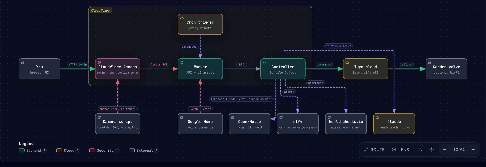

# valve-controller

A cycle-and-soak controller with weather smarts for a Tuya (Smart Life) drip irrigation valve. It waters for N minutes,
soaks for M, and repeats. It scales the number of cycles by how much water the garden is losing, and skips the run for
rain, wet soil, wind or frost. Every run sends an ntfy notification. You can drive it from a web UI or from Google Home.

<p align="center">
  
</p>

## Why this exists

I added schedules in the Smart Life app and they didn't run. I also wanted to decide how much to water from the
evapotranspiration (ET) forecast, which the app can't do. I could have used Home Assistant. These days an AI can write
whatever you need, so I had one build this instead.

Yes, it is AI slop. I'm not asking anyone else to use it. It is public because there is no reason to hide it, and
someone may find a piece of it useful (the Tuya cloud client in `worker/src/tuya.ts` is the part I'd look at first).
Issues and pull requests are not expected and may go unanswered.

## Screenshots

These come from the UI's built-in demo mode (`?demo=watering`, `rain`, `night`), which uses made-up data and no backend.

| Watering | Rain | Night |
| --- | --- | --- |
|  |  |  |

<details>
<summary>Settings</summary>


</details>

## How it works

<p align="center">
  <a href="docs/architecture/architecture.html"></a>
</p>

Everything runs on Cloudflare. Nothing runs at home: the valve is a battery device that only talks to Tuya's cloud, so
Tuya's cloud is the only way to reach it. `worker/` holds the UI, the schedule, the cycle/soak state machine (a Durable
Object with alarms), the weather checks, the valve client, ntfy, and Google Home.

## What it does

- **Cycle and soak:** waters N minutes, soaks M, repeats. The valve's own countdown closes it if Cloudflare ever stops.
- **Rain check:** a scheduled run is skipped when rain is forecast.
- **Weather smarts:** the number of cycles scales with evapotranspiration and soil moisture, and wind, frost or wet soil skip the run.
- **Start times:** a clock time, or relative to sunrise or sunset, as many as you like. Any of them can be an extra run that only happens on a hot day.
- **Alerts:** ntfy for every run, plus a missed-run alert from healthchecks.io and warnings for an expired login, an offline valve and a low battery.
- **Control:** a web UI behind Cloudflare Access, or Google Home.

## Docs

| Page | Covers |
| --- | --- |
| [The valve](docs/valve.md) | how the Worker talks to Tuya, the failsafe, getting the login |
| [The UI and how a run behaves](docs/ui-and-behaviour.md) | the scenes, the rain check, the weather smarts maths |
| [Setup](docs/setup.md) | Terraform, the two-step first deploy, state in R2 |
| [CI/CD and GitHub](docs/ci-and-github.md) | the workflow, secrets, repository settings, Renovate |
| [Google Home and alerts](docs/google-home-and-alerts.md) | linking Google Home, every alert and when it fires |
| [Development](docs/development.md) | devenv, tests, and how the architecture diagram is kept current |

## Development

The toolchain comes from [devenv](https://devenv.sh). With direnv, run `direnv allow` once.

```sh
devenv test
```
