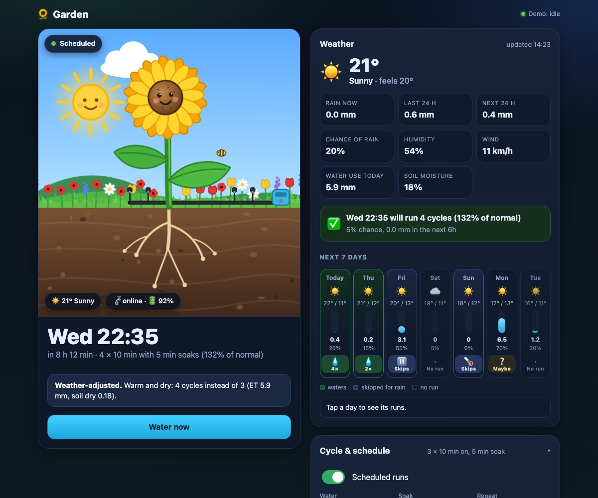
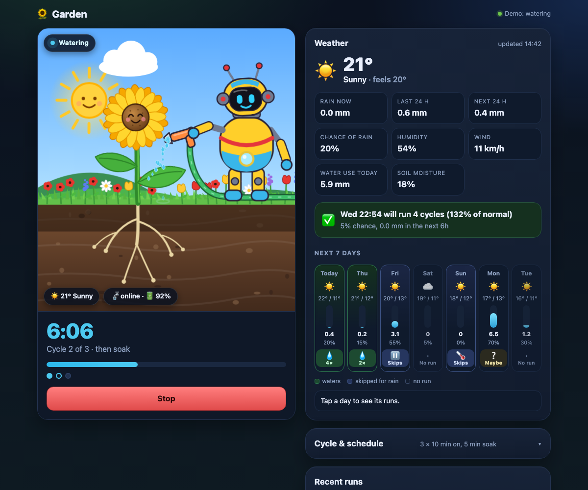
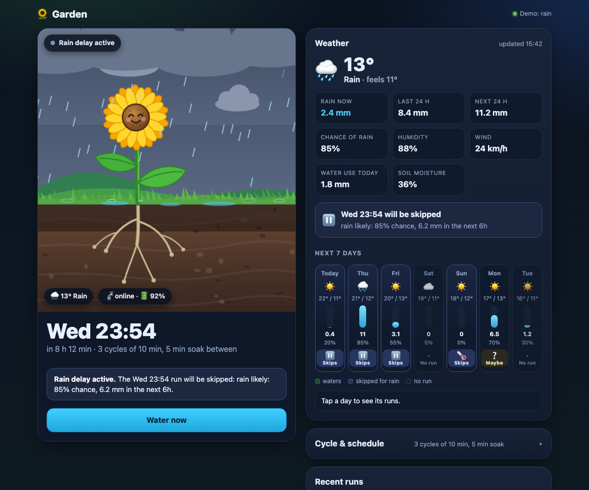
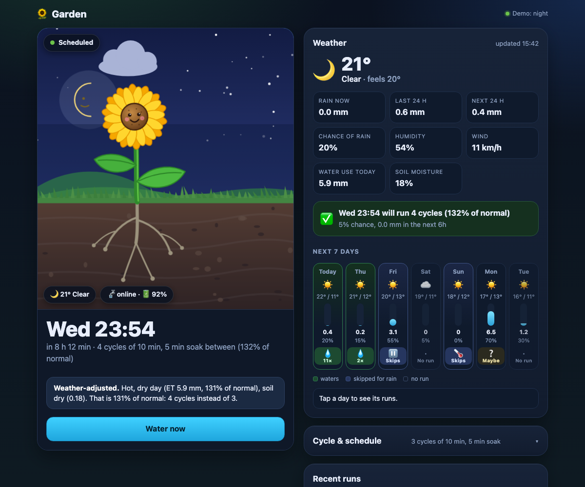
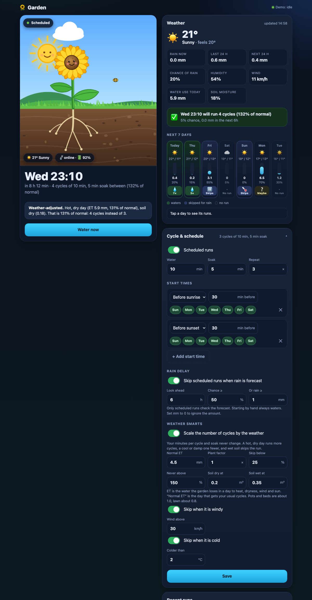

# valve-controller

A cycle-and-soak controller with weather smarts for a Tuya (Smart Life) drip irrigation valve. It waters for N minutes,
soaks for M, and repeats. It scales the number of cycles by how much water the garden is losing, and skips the run for
rain, wet soil, wind or frost. Every run sends an ntfy notification. You can drive it from a web UI or from Google Home.

<p align="center">
  
</p>

## Why this exists

I added schedules in the Smart Life app and they didn't run. I also wanted to decide how much to water from the
evapotranspiration (ET) forecast, which the app can't do. I could have used Home Assistant. These days an AI can write
whatever you need, so I had one build this instead.

Yes, it is AI slop. I'm not asking anyone else to use it. It is public because there is no reason to hide it, and
someone may find a piece of it useful (the Tuya cloud client in `worker/src/tuya.ts` is the part I'd look at first).
Issues and pull requests are not expected and may go unanswered.

## Screenshots

These come from the UI's built-in demo mode (`?demo=watering`, `rain`, `night`), which uses made-up data and no backend.

| Watering | Rain | Night |
| --- | --- | --- |
|  |  |  |

<details>
<summary>Settings</summary>



</details>

```
 browser / Google Home ──▶ Cloudflare Worker ──▶ Tuya cloud ──▶ the valve (battery, Wi-Fi)
                           │  Durable Object: cycle/soak timers, the Tuya login
                           │  cron (every minute): schedule
                           ├─▶ Open-Meteo (rain forecast)
                           ├─▶ ntfy
                           └─▶ healthchecks.io (missed-run alert)
```

Everything runs on Cloudflare. Nothing runs at home: the valve is a battery device that only talks to Tuya's cloud, so
that is the only way to reach it. `worker/` holds the UI, the schedule, the cycle/soak state machine (a Durable Object
with alarms), the rain check, the valve client, ntfy, and Google Home.

## The valve

The Worker controls the valve the way the Smart Life app does. `worker/src/tuya.ts` is a port of Tuya's MIT-licensed
`tuya-device-sharing-sdk` (the library behind Home Assistant's Tuya integration). It is tested against that library's own
output, and against an independent mock of Tuya's server.

- **Opening** sends the on/off command together with the valve's own **countdown** set to the run length plus 90 seconds,
  then asks the valve to confirm it reports open. If the Worker or Cloudflare ever stops, the valve closes itself. That is
  the failsafe. A valve with no countdown function runs without one (`tuya_countdown_code = ""`).
- **The login** is created once by scanning a QR code (below) and is kept in the Worker's private storage. Tuya rotates
  the refresh token each time it is used, so the Worker saves the new one every time and is the only thing that refreshes it.
- **If the login stops working** (revoked in the app, or unused for too long), the check ten minutes before each scheduled
  run sends a priority 5 ntfy saying so. Run `scripts/tuya-login.py` again and apply Terraform.

This relies on an API Tuya does not document for third parties, and signs in with Home Assistant's registered client id
because Tuya has not registered one for this project. It is stable while Home Assistant depends on it, but Tuya could
change it. The alternative is a Tuya developer project (documented, but needs setup and periodic renewal).

**Getting the login.** Open the Smart Life app and copy your **User Code** (Me > settings gear > Account and Security >
User Code) into `infra/.env` as `TUYA_USER_CODE`. Then:

```sh
python3 -m venv scripts/.venv && scripts/.venv/bin/pip install -r scripts/requirements.txt   # once
scripts/.venv/bin/python scripts/tuya-login.py
```

It shows a QR code to scan in the app (Me > the scan icon), finds the valve (category `sfkzq`, or `--device <id>`),
prints what it can do, and saves the login to `infra/.env` and the valve's id and data point codes to
`infra/terraform.tfvars`. The login is **not** signed out: the Worker uses it. It can control every Tuya device on your
account until revoked (Smart Life app > Me > settings > Account and Security). It lives in `infra/.env` (mode 600),
Terraform state and the Worker's storage.

## Architecture diagram

[`docs/architecture/architecture.html`](docs/architecture/architecture.html) is an interactive map of the runtime
(open the file in a browser: click a node for its source references, `R` traces a route). It is generated by
[archify](https://github.com/tt-a1i/archify) from [`architecture.json`](docs/architecture/architecture.json), and every
component cites the lines that back it, verified against a pinned commit.

It is kept up to date with two Claude Code hooks (`.claude/settings.json`) that run `scripts/arch.mjs`:

- **After a commit**, if a file that feeds the diagram (`worker/src`, `wrangler.jsonc`, `infra/*.tf`) changed since the
  diagram was last verified, the agent is told to update it.
- **When the agent stops**, the same check runs once more as a safety net. It also flags a diagram whose JSON was edited
  without regenerating the HTML, or whose last regeneration failed.

```sh
node scripts/arch.mjs check      # is it stale? (exit 1 if so)
node scripts/arch.mjs bump       # pin to HEAD and re-verify every citation, then regenerate
node scripts/arch.mjs finalize   # regenerate after editing architecture.json
```

Setup on a new machine: `npx skills add tt-a1i/archify --skill archify --agent claude-code --copy --yes`. The skill
(17 MB) is not committed; `skills-lock.json` pins it. Without it the hooks do nothing.

The diagram is pinned to this repository on GitHub, so every source reference links to the exact lines at that commit.
`scripts/arch.mjs` verifies citations against a throwaway clone of the pinned revision, so it never touches your checkout.

## The UI

An animated cartoon garden follows the controller, not the buttons you press:

- **Idle**: a sunflower swaying under the real sky (sun, moon and stars, clouds, bee), and the next watering time.
- **Watering**: the drip line along the ground lights up, water runs down the tube and drips from each emitter, but only
  once the controller has confirmed the valve open. The valve box at the end of the line shows a green light while open. Clicking "Water now" changes nothing on screen until the run state comes back.
- **Soaking**: the drips stop, the view slides down to the soil, and droplets seep towards the roots while the moisture
  spreads in step with the soak countdown.
- **Rain**: rain falls only when it is raining now (from the current conditions), with puddles and a darker sky. A rain
  *forecast* on a sunny day only shows the "Rain delay active" notice and why.

The weather card shows current conditions, rain now / last 24 h / next 24 h, chance of rain, humidity, wind, a 7-day
rain outlook with a badge on each day showing whether it will water, skip for rain, or has no run (tap a day for the
times and reasons), and whether the next scheduled run will go ahead. Future days use today's forecast and the same rain
rule the controller applies when a run starts, so they can change as the forecast does. Animations respect
`prefers-reduced-motion`.

To preview every scene without a backend, serve `worker/public` and open `/?demo=idle`, `watering`, `soaking`,
`rain`, `delay` (sunny with a rain delay), `cloudy` or `night`.

## Behaviour

- Settings (water minutes, soak minutes, number of cycles, start times, rain and weather thresholds) live in the UI. A run
  snapshots them at start, so editing mid-run changes nothing until the next run.
- A run is `cycles` watering periods with a soak between each. It ends after the last watering period (no trailing soak).
- Rain check applies to **scheduled** runs only: skip if any hour in the lookahead window is at or above the
  probability threshold, or the forecast total reaches the mm threshold. If the forecast can't be fetched it waters
  anyway and says so in the notification. Starting from the UI or by voice always runs.
- Weather smarts (scheduled runs only, on by default): your minutes per cycle and soak stay fixed, and the **number of
  cycles** scales with the weather. Open-Meteo gives the day's evapotranspiration (ET: the water lost to heat, sun, wind
  and dry air) and modelled soil moisture. `percent = 100 × (ET × plant factor / normal ET) × dryness`, capped at your
  maximum, and `cycles = round(your cycles × percent / 100)` (at least 1). Below your minimum percent, or with wet soil,
  the run is skipped. Frost (cold at the start) and wind gates skip a run whatever the scaling says. Every decision and
  its reason goes in the ntfy message, the history and the UI, and the 7-day outlook shows the planned cycles per day.
  All thresholds are in the UI. Defaults suit pots and beds (normal ET 4.5 mm, plant factor 1); the soil model is on
  a roughly 10 km grid, so treat it as a guide. The forecast is the only input: if it is unavailable the normal
  cycles run.
- A start time can be a clock time or "N minutes before sunrise" (worked out from your latitude and longitude, so it
  follows the seasons).
- Every change of the valve is confirmed by reading its state back. If Tuya can't be reached when a phase changes, it
  retries twice (30s apart), then aborts the run, tries to close the valve and sends a high-priority ntfy.
- Using the Smart Life app while a run is going is safe for the valve (its own countdown still applies), but the
  controller will not notice. The next phase change reads the real state and reports a mismatch.

## Infrastructure as code (Terraform)

`infra/` creates everything on Cloudflare and healthchecks.io. **GitHub Actions applies it** on every merge to `main`.

| Managed by Terraform | Resource |
| --- | --- |
| Worker, assets, bindings, secrets, Durable Object | `cloudflare_worker`, `_worker_version`, `_workers_deployment` |
| Schedule check every minute | `cloudflare_workers_cron_trigger` |
| UI hostname, workers.dev switched off | `cloudflare_workers_custom_domain`, `_workers_script_subdomain` |
| Zero Trust team address | `cloudflare_zero_trust_organization` |
| Login in front of the UI, bypass for Google paths | `cloudflare_zero_trust_access_application` (two) |
| Missed-run alert | `healthchecksio_check` |
| Generated secrets and the ntfy topic name | `random_*`, read back with `terraform output` |

All secrets live in one git-ignored file, `infra/.env` (see `infra/.env.example`). `make` loads it, and
`node scripts/github-setup.mjs secrets` copies it into GitHub when you are ready.

```sh
cd infra
cp .env.example .env                                 # delete the lines you do not use; put ONE broad token in CLOUDFLARE_API_TOKEN
                                                     # (Account API Tokens:Edit + Workers R2 Storage:Edit)
make setup                                           # one time: state bucket, bucket-scoped R2 keys (added to .env), backend.hcl, terraform.tfvars
make token                                           # creates the narrow token Terraform needs, saves it as CLOUDFLARE_API_TOKEN,
                                                     # keeps the broad one as CLOUDFLARE_SETUP_TOKEN
$EDITOR terraform.tfvars                             # zone, hostname, your email, timezone, coordinates
$EDITOR .env                                         # add TF_VAR_healthchecks_api_key
# get the valve login (see "The valve" above)
make init && make apply                              # builds the Worker bundle, then applies
```

### First deploy: two applies

The Durable Object class is created by a migration, and a Worker version cannot bind to a class that does not exist yet.
Terraform's provider has a one-step setting for this (`exports`), but v5.28 fails to convert it, so the first deploy
takes two applies, controlled by `durable_object_ready` in `terraform.tfvars`:

1. `durable_object_ready = false` (the default): deploys the Worker with the migration and no binding.
2. `durable_object_ready = true`: deploys a new version with the binding. Leave it `true` from then on.

Every apply after that is a single step, and CI uses the `true` setting because it reads `terraform.tfvars`. Only a
brand new Worker (a new `worker_name`) needs the two steps again.

`make token` gives Terraform only what it manages: Workers Scripts, Access apps and the Zero Trust organisation on the
account, and Zone Read, DNS and Workers Routes on your zone. Run it again with `--rotate`
(`node terraform-token.mjs --rotate`) after you add your domain and set `zone_name`, to narrow the zone permissions from
"all zones in the account" to that one zone. The broad setup token can create other tokens, so delete it in the
dashboard once you no longer need it (`make setup` and `make token` need it again for a rotation).

`make` uses `terraform` and the committed lock files are for it. OpenTofu works too (`make apply TF=tofu`) but rewrites
the lock files.

Still manual, because there is no API for them:

- **Activating Zero Trust, once.** Cloudflare's API refuses to create the organisation until you press "Enable Access"
  in the Zero Trust dashboard (pick the team name and the Free plan). After that, Terraform takes over the organisation:
  set `zero_trust_team` in `terraform.tfvars` to the team name you chose, then
  `terraform import cloudflare_zero_trust_organization.this <account_id>` (in `infra/`, with `.env` loaded).
- Creating the healthchecks.io account and its ntfy or email integration.
- The Tuya login (scanning the QR code with your phone).
- The Google Home developer console project. `terraform output google_home` prints every value to paste into it.
- Subscribing to the ntfy topic (`terraform output ntfy_topic`).

### State

Terraform state holds every secret (the Tuya login, signing key, passwords), so it is never committed. It lives in a
private Cloudflare R2 bucket, `valve-controller-tfstate`, through Terraform's S3 backend.

`make setup` does the one-time work (it is safe to run again):

1. creates the bucket;
2. creates R2 keys that can only read and write that bucket (the key id is the token id, the secret is the SHA-256 of the
   token value, as R2 expects) and saves them to `infra/.env` (mode 600, git-ignored; `make` loads it);
3. writes `backend.hcl` (git-ignored, it only holds your account id) and, if missing, `terraform.tfvars` with your
   account id filled in.

To replace the keys later (and revoke the old ones) run `node setup.mjs --rotate`. If creating keys is refused (the token
lacks permission), the script says so, and you can create them in the dashboard instead (R2 > Manage R2 API tokens >
Object Read & Write on that bucket) and put the two values in `infra/.env`.

On a new machine, `make setup` finds the bucket, mints a second set of keys for that machine (the first machine keeps
working) and rewrites `backend.hcl`. There is no state locking, so run one `apply` at a time.

Terraform is the source of truth for the Worker's variables and secrets. `worker/wrangler.jsonc` is only used for
`wrangler dev` and for building the bundle, so do not `wrangler deploy`: it would replace what Terraform set.

The Tuya login in state is only the seed. The Worker keeps the live, rotating copy in its own storage and ignores the
seed unless you log in again (a later login replaces it), so applying Terraform never resets a working login.

## CI/CD and GitHub

`.github/workflows/ci.yml` runs on every pull request and every push to `main`:

| Job | What it does |
| --- | --- |
| Worker | typecheck, tests, and the same bundle build Terraform deploys |
| Scripts | the Python tests for `tuya-login.py`, and a syntax check of the Node scripts |
| Terraform | `fmt`, `init -backend=false`, `validate` against the locked providers |
| Architecture diagram is current | warns (does not block) when the diagram is behind the code |
| `ci-ok` | one gate that fails if any of the above failed. Branch protection, if you turn it on, requires this check |
| Terraform plan / apply | `plan` on every run, `apply` only on `main`, one run at a time (the state has no locking) |

Every action is pinned to a commit. The plan and apply job needs the secrets and variables below and does nothing
until they exist: it prints which ones are missing and exits cleanly.

```sh
node scripts/github-setup.mjs secrets    # copies infra/.env and infra/terraform.tfvars into GitHub
node scripts/github-setup.mjs secrets --dry-run   # shows the names it would set, never the values
```

| Where | Name | Comes from |
| --- | --- | --- |
| secret | `CLOUDFLARE_API_TOKEN`, `AWS_ACCESS_KEY_ID`, `AWS_SECRET_ACCESS_KEY`, `TF_VAR_healthchecks_api_key`, `TF_VAR_tuya_session`, `TF_VAR_ntfy_token` | `infra/.env` |
| variable | `TFVARS`, `CLOUDFLARE_ACCOUNT_ID` | `infra/terraform.tfvars` |

Anyone who can change a workflow on a branch can read these secrets when it runs, so keep the repository private or
single-owner. The repository is public, so workflows from outside contributors' pull requests wait for your approval and
fork runs never receive secrets. Branch protection is off, so a push to `main` deploys.

**Repository settings** are code too: `node scripts/github-setup.mjs settings` (safe to repeat) sets squash-only merges,
deletes merged branches, turns Dependabot alerts on and makes workflow tokens read-only. Branch protection is
optional and off by default: add `--protect` to require a pull request with a passing `ci-ok`, no force pushes, no
deletion and linear history (it needs GitHub Pro on the repo owner's account, or a public repository).

**Dependencies.** Dependabot alerts watch for known vulnerabilities. Renovate (`renovate.json`) opens the update PRs,
including the security ones it reads from those alerts, so Dependabot's own security PRs are switched off to avoid
duplicates. It covers the Worker's npm packages, the scripts' Python packages, Terraform providers and lock files and the
Actions pins. Dev tooling patches and Actions pins merge themselves once CI is green; everything that changes runtime
behaviour waits for you. Renovate runs as a GitHub App: install it once at <https://github.com/apps/renovate> and give it
this repository.

## Google Home (optional)

Smart Home Actions are free for personal use and don't need review while the project is in testing.

1. In the [Google Home developer console](https://console.home.google.com/) create a project and a cloud-to-cloud
   integration. `terraform output google_home` prints the client id, secret and the three URLs to enter.
2. Set `google_project_id` in `terraform.tfvars` and apply.
3. In the Google Home app: add device, "Works with Google", pick your project, enter `link_password` when asked
   (`terraform output -raw link_password`).

The valve appears as a sprinkler called "Garden water": "turn on / off the garden water" or "start / stop".

## Alerts

ntfy messages tell you what happened. These catch what didn't:

| Alert | Where | Fires when |
| --- | --- | --- |
| Missed run | healthchecks.io | a scheduled run does not report in, so the schedule, Worker or Cloudflare is down |
| Cannot reach the valve | ntfy, 10 min before each scheduled start | Tuya's cloud did not answer |
| Tuya login expired | ntfy, same check, priority 5 | the saved login no longer refreshes: run `scripts/tuya-login.py` |
| Valve offline | ntfy, same check | Tuya reports the valve offline: check its Wi-Fi and batteries |
| Low battery | ntfy, same check | the valve reports 20% or less |
| Open while idle | ntfy, same check, priority 5 | the valve is open with no run active |

Only **scheduled** runs report to healthchecks.io: `/start` when a run begins, a success ping when it finishes or is
skipped for rain (that is a run that did its job), and `/fail` when it errors. A run that starts and never finishes shows
up as a missed run too. If you switch scheduled runs off in the UI or go away, pause the check in healthchecks.io.

Subscribe to `terraform output ntfy_topic` in the ntfy app. The topic name is generated and hard to guess, which is the
only protection on the public ntfy server. Set `ntfy_url` to your own server (it must be reachable from Cloudflare) and
add `ntfy_token` to lock it down.

## Development

```sh
cd worker && npm install && npm test && npm run typecheck
python3 -m venv scripts/.venv && scripts/.venv/bin/pip install -r scripts/requirements.txt && scripts/.venv/bin/python -m unittest discover -s scripts/tests
```

For `wrangler dev`, copy `worker/.dev.vars.example` to `worker/.dev.vars`; it sets `DEV_BYPASS_ACCESS=true`, which must
never be set in production. Minimum cycle and soak times of 0.1 minutes are allowed so a whole run can be tried in under
a minute against a fake Tuya server.
